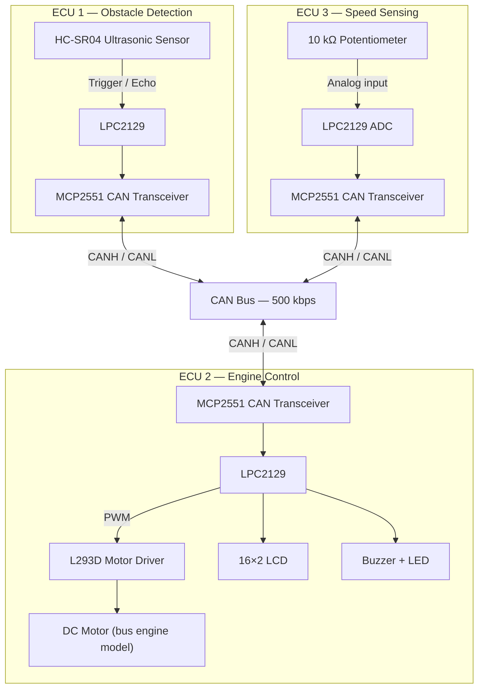

# CAN-Based Intelligent Bus Accident Prevention and Automatic Braking System Using LPC2129

## 1. Abstract

This project implements a three-node Controller Area Network (CAN) system using LPC2129 microcontrollers. It detects an obstacle in front of a bus and automatically reduces the motor speed or stops the motor when the measured distance becomes unsafe.

The system contains three ECUs:
- **ECU1 – Obstacle Detection:** Uses an HC-SR04 ultrasonic sensor to measure the distance to an obstacle.
- **ECU2 – Engine Control:** Receives distance and speed information, decides the braking level, and controls a DC motor through an L293D motor driver.
- **ECU3 – Speed Sensing:** Uses a potentiometer connected to the LPC2129 ADC to simulate the vehicle speed sensor.

All three ECUs communicate through a two-wire CAN bus using MCP2551 CAN transceivers. This is a laboratory prototype: the DC motor represents the bus engine and the potentiometer simulates the speed sensor.

## 2. Objectives

- Measure obstacle distance using an HC-SR04 ultrasonic sensor.
- Simulate vehicle speed using a potentiometer and the LPC2129 ADC.
- Exchange distance and speed data between ECUs using CAN.
- Automatically reduce motor speed or stop the motor based on distance and speed.
- Display distance, speed, and braking state on a 16×2 LCD.
- Provide warning indications using an LED and buzzer.

## 3. System Architecture

The project uses three LPC2129-based ECUs. Each ECU has an MCP2551 CAN transceiver connected to the common CAN bus.

### Block Diagram

**Data flow:**
1. ECU1 measures obstacle distance and sends CAN frame `0x100`.
2. ECU3 reads the potentiometer through the ADC, scales the result to 0–100%, and sends CAN frame `0x200`.
3. ECU2 receives both frames, selects a braking zone, controls motor PWM, updates the LCD and warning outputs, and broadcasts brake status using CAN frame `0x300`.

## 4. ECU Functions

| ECU | Function | Input / output | CAN role |
|---|---|---|---|
| ECU1 | Obstacle detection | HC-SR04 input; distance in cm | Transmitter |
| ECU2 | Engine control | L293D/DC motor, LCD, buzzer and LED | Receiver and brake-status transmitter |
| ECU3 | Speed sensing | Potentiometer input through ADC; speed in percent | Transmitter |

## 5. Hardware Requirements

| Component | Quantity | Used in | Purpose |
|---|---:|---|---|
| LPC2129 development board | 3 | ECU1, ECU2, ECU3 | CAN node controller |
| MCP2551 CAN transceiver | 3 | ECU1, ECU2, ECU3 | Interfaces CAN controller to CANH/CANL |
| HC-SR04 ultrasonic sensor | 1 | ECU1 | Measures obstacle distance |
| 10 kΩ potentiometer | 1 | ECU3 | Simulates vehicle speed sensor |
| DC motor | 1 | ECU2 | Represents the bus engine |
| L293D motor driver | 1 | ECU2 | Drives the motor using PWM |
| 16×2 LCD | 1 | ECU2 | Displays distance, speed and brake state |
| Buzzer | 1 | ECU2 | Warning indication |
| LED | 1 | ECU2 | Warning indication |
| 120 Ω resistors | 2 | CAN bus ends | Bus termination |
| 5 V and 12 V supplies | As required | All | Board, sensor and motor power |

## 6. LPC2129 Pin Connections

The following are the suggested pin assignments from the project design. Check the development-board schematic and LPC2129 pin-function table before wiring.

| ECU | Signal | LPC2129 pin | Connection / note |
|---|---|---|---|
| ECU1 | Ultrasonic trigger | P0.4 | GPIO output; 10 µs trigger pulse |
| ECU1 | Ultrasonic echo | P0.5 | GPIO input; pulse width measured using Timer0 |
| ECU1 | CAN TD1 / RD1 | P0.24 / P0.25 | To MCP2551 TXD / RXD |
| ECU2 | Motor PWM | P0.0 (PWM1) | To L293D enable input |
| ECU2 | LCD data and control | Port 1 GPIO | LCD 4-bit mode |
| ECU2 | CAN TD1 / RD1 | P0.24 / P0.25 | To MCP2551 TXD / RXD |
| ECU3 | Potentiometer wiper | P0.28 (AD0.1) | 10-bit ADC input |
| ECU3 | CAN TD1 / RD1 | P0.24 / P0.25 | To MCP2551 TXD / RXD |

## 7. CAN Bus Design

- **Protocol:** CAN 2.0A, standard 11-bit identifiers.
- **Bit rate:** 500 kbps.
- **Peripheral clock used in the design:** 60 MHz.
- **CAN transceiver:** MCP2551 on each ECU.
- **Bus wiring:** Twisted-pair CANH and CANL.
- **Termination:** 120 Ω at each physical end of the bus.
- **Transmit period:** ECU1 and ECU3 send data every 100 ms.
- **Acceptance filter:** ECU2 accepts identifiers `0x100` and `0x200`.
- **Fail-safe:** If ECU2 does not receive a distance frame for several transmission periods, it slows the motor and raises a warning.

Lower CAN identifiers have higher arbitration priority. Therefore, distance frame `0x100` has higher priority than speed frame `0x200`.

### CAN Message Format

| Message | CAN ID | Sender | Receiver | Data length | Payload |
|---|---|---|---|---:|---|
| Distance | `0x100` | ECU1 | ECU2 | 2 bytes | Bytes 0–1: distance in cm |
| Speed | `0x200` | ECU3 | ECU2 | 1 byte | Byte 0: speed, 0–100% |
| Brake status | `0x300` | ECU2 | All nodes | 1 byte | Byte 0: 0 = normal, 1 = warning, 2 = brake |

The identifiers and payload layout are design choices for this prototype. Ensure the transmitting and receiving firmware use the same byte order and scaling.

## 8. Working Principle

### ECU1 – Ultrasonic Obstacle Detection

1. Initialize GPIO, Timer0 and CAN at 500 kbps.
2. Generate a 10 µs pulse on the HC-SR04 trigger pin.
3. Wait for the echo signal to go high and start Timer0.
4. Measure the echo pulse duration until the signal goes low.
5. Calculate distance using:

   `Distance (cm) = Echo time (µs) / 58`

6. Place the distance in CAN frame `0x100` and transmit it.
7. Repeat every 100 ms.

### ECU3 – Speed Sensing

1. Initialize the ADC channel and CAN at 500 kbps.
2. Read the 10-bit ADC conversion result from the potentiometer.
3. Scale the ADC reading to a speed value from 0–100%.
4. Place the speed value in CAN frame `0x200` and transmit it.
5. Repeat every 100 ms.

### ECU2 – Engine Control and Automatic Braking

1. Initialize PWM, LCD, buzzer, LED and CAN.
2. Configure the CAN acceptance filter for frames `0x100` and `0x200`.
3. Receive and store distance and speed values.
4. Select the braking zone based on distance, with an additional margin at high speed.
5. Set motor PWM duty for the selected zone.
6. Operate the buzzer and LED as required.
7. Display distance, speed and zone on the LCD.
8. Transmit brake status in CAN frame `0x300`.
9. If the distance message times out, slow the motor and raise a warning.

## 9. Braking Logic

The following distance zones are the starting values specified for the prototype:

| Zone | Distance to obstacle | ECU2 action | Indication |
|---|---|---|---|
| Safe | Above 100 cm | Motor runs at speed set by ECU3 | None |
| Caution | 60–100 cm | Gradually reduce PWM duty | LED ON |
| Danger | 30–60 cm | Reduce PWM duty sharply | Buzzer beeps |
| Brake | Below 30 cm | Stop motor (PWM duty 0) | Continuous buzzer; LCD shows `BRAKE` |

At high speed, ECU2 starts braking earlier. The example control logic adds a 20 cm margin when the speed value is above 70%.

## 10. Software and Development Tools

- Embedded C
- Keil µVision
- ARM compiler / LPC2129 device support
- Flash Magic
- UART bootloader for programming
- LPC2129 datasheet and user manual

Each ECU runs its own firmware loop. Build and program the three ECU firmware images separately.

## 11. Testing Plan and Expected Results

| Test | Condition | Expected result |
|---|---|---|
| Distance reading | Place an obstacle at a known distance | LCD shows the measured distance within sensor tolerance |
| Speed reading | Turn the potentiometer | Speed value follows the knob from 0–100% |
| CAN link | Power all three nodes | ECU2 receives frames `0x100` and `0x200` every 100 ms |
| Safe zone | Obstacle above 100 cm | Motor runs at the speed set by ECU3 |
| Brake zone | Obstacle below 30 cm | Motor stops and buzzer sounds continuously |
| Obstacle removed | Move obstacle away | Motor speed returns to the set speed |
| Fail-safe | Disconnect ECU1 | ECU2 slows the motor and raises a warning |

Record actual measured values during bench testing; the table lists expected results, not measured experimental results.

## 12. Advantages

- Automatic motor braking does not depend only on driver reaction.
- CAN allows multiple ECUs to share data using two bus wires.
- CAN provides error detection and priority-based arbitration.
- Additional ECUs, such as a rear obstacle sensor, can be added to the network.

## 13. Limitations

- HC-SR04 has a short range (approximately 4 m) and may give incorrect readings from soft or angled surfaces.
- The potentiometer simulates vehicle speed; an actual vehicle requires a suitable wheel-speed sensor.
- The prototype controls a small DC motor, not a real vehicle brake actuator.
- The prototype is for laboratory demonstration and is not suitable for installation in a road-going bus.

## 14. Applications

- Educational bus and truck safety prototypes.
- CAN-based automotive embedded-system demonstrations.
- Collision-warning and automatic motor-control research.

## 15. Future Scope

- Replace the ultrasonic sensor with radar or LiDAR for longer detection range.
- Use a wheel-speed sensor instead of a potentiometer.
- Integrate a suitable pneumatic or electronic brake actuator with a validated safety design.
- Add GPS and GSM for accident alerts.
- Add driver drowsiness detection as a fourth CAN node.

## 16. Conclusion

This project demonstrates a three-ECU embedded system using LPC2129 microcontrollers and CAN communication. ECU1 detects obstacles, ECU3 provides a simulated speed value, and ECU2 uses the received information to control motor speed and demonstrate automatic braking in stages. The distributed ECU architecture reflects a common approach in automotive electronics and provides a platform for further safety-related development.

## 17. References

1. NXP – LPC2129 User Manual and Datasheet.
2. Bosch – CAN Specification 2.0.
3. Microchip – MCP2551 High-Speed CAN Transceiver Datasheet.
4. HC-SR04 Ultrasonic Ranging Module Datasheet.

---

**Project title:** CAN-Based Intelligent Bus Accident Prevention and Automatic Braking System Using LPC2129

**Repository note:** Add your own name, institution, guide details, source-code folders, and measured test results before publishing.
